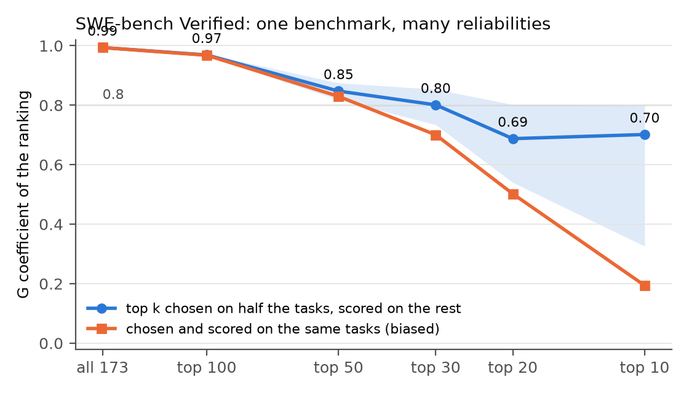

# benchmeasure

**Three standard psychometric checks, run on AI benchmarks: does the score replicate, does a task mean the same for every model, and how much can the score predict. One command, any results file.**

Leaderboards rank models as if every gap in the score were real. Psychologists have spent a century working out when a test score can be trusted, and benchmeasure applies those same checks to AI benchmarks: would the ranking come out the same on a fresh set of tasks, does a task mean the same thing for every kind of model, and how much can the score tell you about performance somewhere else.

Run on SWE-bench Verified, the answer splits in two. The leaderboard as a whole is very reliable, and its top is not: among the leading systems, where the comparisons people care about happen, neighbouring entries can't be told apart. In the paper's terms, G, the share of score variance that reflects real differences between systems, is 0.994 across all 173 submissions and about 0.68 for the top 20, where none of the 19 neighbouring pairs can be told apart. Measuring the top k's reliability on the same tasks that picked them understates it badly: 0.19 for the top 10, against 0.69 when the tasks are split.



This repo holds the tool and the paper that ties together three studies:

| question | repo | headline |
| --- | --- | --- |
| reliability and the validity ceiling | [agent-validity-ceiling](https://github.com/abhaymettu/agent-validity-ceiling) | SWE-bench Verified: G 0.994 for the whole board, about 0.68 for the top 20; coverage of Multilingual 0.96 (CI 0.63 to 1.00; 0.80 without the weakest model) |
| invariance | [benchdif](https://github.com/abhaymettu/benchdif) | item-level DIF between model families is 6 to 10 times sampling noise, cancels in full scores, breaks 100-item subsets |
| the scorer | [judge-reliability](https://github.com/abhaymettu/judge-reliability) | GPT-4 as judge on MT-Bench: 83.4% agreement with the human majority against a human ceiling of 88.2% on the same items, 87.1% when it judges both answer orders; its order-swap flip rate (16.1%) matches its rerun disagreement (16.2%) |

Paper: [paper/benchmeasure.pdf](paper/benchmeasure.pdf) (12 pages). Write-up: [abhaymettu.com/research/benchmeasure](https://www.abhaymettu.com/research/benchmeasure/).

## Install

```sh
pip install git+https://github.com/abhaymettu/benchmeasure
```

Python 3.12 or newer. It pulls [benchdif](https://github.com/abhaymettu/benchdif) for item-level DIF.

## Quick start

```sh
benchmeasure demo
```

```
benchmeasure report: SWE-bench Verified, 173 public submissions (group 1 = open-weight models; criterion = SWE-bench Multilingual, same scaffold)
173 models x 500 tasks

1. Reliability (generalizability theory, models x tasks)
   whole board   G = 0.994   model SD 19.0 pp   score SEM 1.5 pp
   top 10        G = 0.690   model SD 1.6 pp   tasks for G = 0.9: 2,023
   top 20        G = 0.682   model SD 1.6 pp   tasks for G = 0.9: 2,096
   (top k chosen on half the tasks and scored on the other half, 50 splits; slightly optimistic, while the same-task estimate is biased low)

   leaderboard neighbours in the top 20: 0 of 19 separable by exact McNemar at 0.05; smallest gap detectable at 80% power about 4.3 pp

2. Invariance (group 1 vs group 0)
   test-level gap -1.2 pp; per-task gap variance 1.39x sampling noise within score bands (28% task-specific)
   a 50-task subset chosen on other models moves the gap by up to 4.7 pp; the two most adversarial subsets differ by 8.2 pp
   random 50-task subsets reverse the gap's sign 12.5% of the time

3. Validity ceiling against the criterion (12 shared models)
   observed r = 0.932; reliabilities 0.953 and 0.954
   true-score r = 0.978; coverage C = 0.956 (95% CI 0.63 to 1.00)
   ceiling R^2 <= rho_x * rho_y * C = 0.869
```

On your own results:

```sh
benchmeasure report results.csv                                   # wide: model column, one column per task
benchmeasure report runs.jsonl                                    # long: model, task, score (repeated runs averaged)
benchmeasure report results.csv --groups meta.csv --group-col open_weights
benchmeasure report bench_a.csv --criterion bench_b.csv           # same models on a second benchmark
benchmeasure report results.csv --json
```

Or from Python:

```python
from benchmeasure.reliability import gstudy
from benchmeasure.ceiling import estimate_coverage
g = gstudy(X)                   # X: models x tasks array
g.g_coef, g.tasks_for(0.9)
```

## The results

Every SWE-bench number below is written by `experiments/swebench.py` to [`results/swebench.json`](results/swebench.json) with fixed seeds, and `tests/test_reproduce.py` regenerates that file byte for byte.

```sh
git clone https://github.com/abhaymettu/benchmeasure && cd benchmeasure
uv run python experiments/swebench.py
uv run pytest
```

**Reliability depends on who you compare.** Across all 173 submissions the true spread is about 19 points against a score error of 1.5, and the ranking's G coefficient is 0.994. Among the top 20 the spread is 1.6 points and G is about 0.68. None of the 19 adjacent top-20 pairs is separable, and a paired test needs a true gap of about 4.3 points to detect it reliably, nearly the top 20's whole spread of 4.8. Getting top-20 reliability to 0.9 would take about 2,100 tasks.

**The usual estimate is biased.** Picking the leaders and computing their reliability on the same tasks gives 0.19 for the top 10, because the leaders were picked partly for noise that ran in their favour. Picking on half the tasks and measuring on the other half gives 0.69, slightly optimistic; a cross-check from the correlation between task halves gives 0.61. (Top 10 and top 20 come out about the same; the difference is inside the band in the figure.)

**Coverage can be measured.** Twelve models run with the same scaffold on Verified and on Multilingual correlate 0.93, and 0.98 after correcting each score for its own noise. That puts coverage, the share of Multilingual's true signal that Verified captures, at 0.96 (interval 0.63 to 1.00), or 0.80 without the weakest model. In both cases the two noise terms are larger than the uncovered term. The first version of agent-validity-ceiling assumed coverage of 0.25 and blamed it; for near transfer the evidence points at noise instead.

**Invariance holds in full scores and fails in subsets.** Between open- and closed-weight submissions the per-task gap has 1.39 times its sampling variance within score bands, and 8 of 500 tasks show DIF. The full-score gap is 1.2 points; a 50-task subset chosen on other base models moves it by up to 4.7. The published 50-task SWE-bench Verified Mini keeps the overall ranking (Spearman 0.95) but ranks the top 20 no better than random 50 tasks do (0.36, against a random median of 0.42), because 50 tasks are too few to order systems a point apart. On the Open LLM Leaderboard the family pattern is much stronger (see [benchdif](https://github.com/abhaymettu/benchdif)).

## How it works

| check | method | module |
| --- | --- | --- |
| reliability | two-way random effects G-study (models x tasks, optionally x runs), D-study projection, split-task estimate for top k with a halves cross-check | `reliability.py`, `report.py` |
| pairs | exact McNemar on shared tasks, minimum detectable difference | `compare.py` |
| invariance | excess per-task gap variance within score bands, held-out subset shift (clustered by base model), random subset stability, logistic DIF via benchdif | `invariance.py` |
| validity ceiling | R^2 <= rho_X rho_Y C, four-way decomposition, coverage from disattenuated cross-benchmark correlation with a model bootstrap | `ceiling.py` |

The G coefficient equals Cronbach's alpha on the same matrix (a test checks this to 1e-12); the McNemar test matches statsmodels; the estimators recover known variance components in simulation.

## What is new compared with the closest work

Generalizability theory has been applied to agent benchmarks before (Srinivasan 2026; Hardy et al. 2026, including the 50-task SWE-bench Verified Mini), and Liu et al. 2026 showed that adjacent top-30 SWE-bench pairs are not separable. Zheng and Yang 2026 found family DIF that leaves aggregate rankings intact. What we did not find elsewhere: reliability traced across comparison populations on the full 500 tasks, the winner's-curse correction for top-k reliability, a validity ceiling whose coverage is measured from matched runs, and one tool that reports all three checks for any results file. The paper's related work section has the details and citations.

## Limits

- One run per public submission. Run-level variation is folded into the model variance, so G is somewhat optimistic about reruns; published run variance only bounds the split.
- Coverage rests on 12 matched models (0.96, or 0.80 without the weakest) and measures near transfer only. Coverage of deployment usefulness is unmeasured anywhere public.
- DIF is a symptom. Nothing here attributes it to training data, and nothing here shows contamination.
- Within one population the ceiling equals the observed R^2 by construction (0.953 x 0.954 x 0.956 = 0.932^2). Its use is attributing the shortfall to noise or coverage, not predicting a new number.
- The disattenuated correlation is unstable when reliabilities are low; the tool reports intervals, and the ceiling is a bound, not a prediction.

## Files

| Path | What it is |
| --- | --- |
| `src/benchmeasure/` | the library and CLI |
| `src/benchmeasure/data/` | SWE-bench Verified (173 x 500) and Multilingual (14 x 300) matrices, the Mini task list, and the source commit |
| `data/build_swebench.py` | rebuilds the matrices from a checkout of SWE-bench/experiments |
| `experiments/swebench.py` | every SWE-bench number in the paper |
| `results/`, `figures/` | its outputs |
| `paper/` | LaTeX source, PDF, bibliography, literature notes, submission steps |
| `site/` | write-up for the project page |
| `AGENTS.md` | notes for coding agents |

## Cite

```bibtex
@misc{mettu2026benchmeasure,
  author = {Mettu, Abhay},
  title  = {Benchmarks Are Measurement Instruments: Reliability, Invariance and Validity Ceilings for LLM and Agent Evaluation},
  year   = {2026},
  url    = {https://github.com/abhaymettu/benchmeasure}
}
```

Data: SWE-bench/experiments (public per-submission results), SWE-bench Verified Mini task list (MariusHobbhahn/swe-bench-verified-mini on Hugging Face). MIT license for the code.
